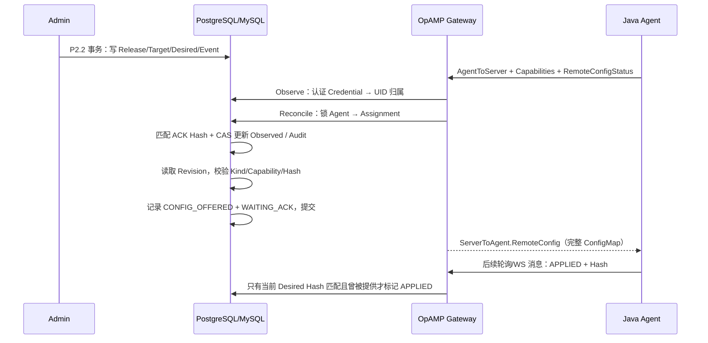

# P2.3：持久 Desired → OpAMP 投递 → ACK 收敛

> 状态：P2.3 增量实现说明；不取代 DD-001 的 Draft 或 EP-001 的身份安全阻塞。本文件描述当前单 Agent Java RemoteConfig 的可执行范围和待实现边界，不批准生产身份认证或多实例 HA 语义。

## 1. 目标与边界

基于 P2.2 已提交的 `config_revisions`、`config_releases`、`release_targets`、`agent_assignments` 和 `config_events`，让已经建立可信 Workspace/Agent 凭证绑定的 Java Agent 从 OpAMP HTTP 轮询或 WS 消息响应中获取完整 ConfigMap，并以报告的 RemoteConfigStatus 和 Hash 收敛当前 Assignment。

P2.3a 和 P2.3b 均不增加物理表、消息队列或独立进程。只有已经发布到指定 `workspace_id + instance_uid` 的 Revision 可以下发。发送响应不表示接收、应用或真实 JVM 动态采样成功。

## 2. 执行顺序

1. 无 Assignment 的心跳只做一次存在性查询，不写审计、不打开协调事务。
2. 有 Assignment 时遵循发布路径的 Agent → Assignment 加锁顺序，防止并发发布与 ACK 的锁反转。
3. 仅当 Observed Hash/Status、当前版本错误信息或业务状态发生改变，才更新 `row_version`、`observed_at`，并在同事务追加事件；匹配的 FAILED 回执记录 Assignment/Target `last_error` 与审计详情。
4. 已经 `APPLIED`、`FAILED`、`UNSUPPORTED` 的当前版本不重发；`WAITING_ACK` 每 15 秒允许下一次 Agent 消息触发重复提供。
5. `CONFIG_OFFERED` 和 `last_sent_at` 表示网关准备响应配置的尝试，不保证网络发送成功。真实响应发送发生在事务提交之后。
6. 单 Agent Target/Release 在回执收敛时更新为 `APPLIED` 或 `FAILED`；每次状态写入均通过 Generation/RowVersion CAS 守护当前 Assignment。

## 3. Hash 和事件合同

| Agent 回执 | 当前状态处理 | 审计事实 |
| --- | --- | --- |
| 当前 Hash + APPLIED，且当前版本曾提供 | `APPLIED` | `CONFIG_APPLIED` |
| 当前 Hash + FAILED，且当前版本曾提供 | `FAILED` | `CONFIG_FAILED` |
| 当前 Hash + APPLYING，且当前版本曾提供 | `APPLYING` | `CONFIG_APPLYING` |
| 旧 Hash 或未曾提供的 Hash | 当前 Pending 不冒认成功；保留 Observed Hash/Status | `CONFIG_ACK_STALE` |
| 没有新回执但等待期限结束 | 再次提供完整 ConfigMap，`WAITING_ACK` | `CONFIG_OFFERED` |
| AgentKind、Dialect、Distribution 或 Capability 不兼容 | `UNSUPPORTED`，不返回 ConfigMap | `CONFIG_UNSUPPORTED` |

**相同 Hash、不同 Release**：当前 Hash 匹配可以证明内容状态，不能证明新 Release 发生了独立的 JVM 应用动作。Agent 回执不携带服务端 Generation，Generation 只用于数据库 CAS。

ConfigMap 内容使用 P2.1 确定性 protobuf Bytes。投递前以 SHA-256 重新验证 `config_hash` 与 Assignment DesiredHash 一致，禁止把不一致内容发送给 Agent。

## 4. 恢复和后续工作

- **HTTP**：每次轮询读取数据库 Desired，不依赖进程内待发队列；进程重启后可以继续。
- **WebSocket P2.3b**：首次收到通过归属认证的 Agent 消息后，建立一个 WS Session Writer。对于持久 Assignment，OnMessage 仅对账 ACK，不同步发送 ConfigMap；后台 Writer 按 Workspace + UID 读取最新 Desired，通过 OpAMP `Connection.Send` 主动推送。上游 opamp-go v0.25.0 在 WS connection 内使用互斥锁序列化实际写入。P0 `PUT /sampling` 的内存演示链路继续保留。
- **Admin 唤醒**：发布事务提交后，在成功 HTTP 202 分支无阻塞投递一个容量为 1 的唤醒信号；合并通知不影响语义，因为每次读取持久 Assignment。Admin 不等待网络 Send。
- **离线/重启恢复**：Desired 持久保留；HTTP 通过下一次轮询恢复，WS 在完成身份认证并发送首个 Agent 消息后启动 Writer，从数据库读取最新配置。无法向尚未重新连线的 Agent 主动发送。
- **重试**：持久 `next_retry_at` 仍是固定 15 秒；在线 WS 在未提供新配置的检查后将周期从 5 秒倍增至最多 40 秒，发布唤醒不受检查间隔影响。重连后未 ACK 的版本仍受持久期限约束，漏掉唤醒时最多等待当前检查间隔；不扫描离线 Agent，也不增加新队列或 Migration。终态 FAILED/UNSUPPORTED 需要新发布。
- **证据界限**：`CONFIG_OFFERED` 只表示网关准备发送，不代表对端收到；依然只以匹配 Hash 的回执更新 APPLIED。当前单进程 Session 不提供多实例推送、跨节点订阅或全局 Session Fencing。
- **平台安全**：继续使用现有静态配置绑定的 Workspace/Agent Token；未解决 DD-001、EP-001 所跟踪的正式 IAM 与稳定 Principal 阻塞。
- **状态查询**：Assignment 是 P2.3 当前状态事实源，P0 `PUT /sampling` 与旧 Agent List 视图仍属于兼容演示，不承诺展示持久 Desired。纯运行时 Session 在无连接、无 P0 演示配置且空闲超过 5 分钟后按请求机会回收，不删除持久 Inventory。

## 5. 验证

要求 PR Head 上严格 gofmt、go test -race、go vet、RepoFoundry 校验通过；真实 PostgreSQL 17 / MySQL 8.4 运行 OpAMP HTTP 端到端用例，验证发布后响应完整 Hash/ConfigMap、等待 ACK 不重复提供、相同 Hash APPLIED 收敛、新发布旧 ACK 不污染 Generation、跨 Workspace 查询不泄露。

不能以这些测试替代 WS 主动推送、网络断开、实际 JVM 采样与生产身份/HA 的验收。
