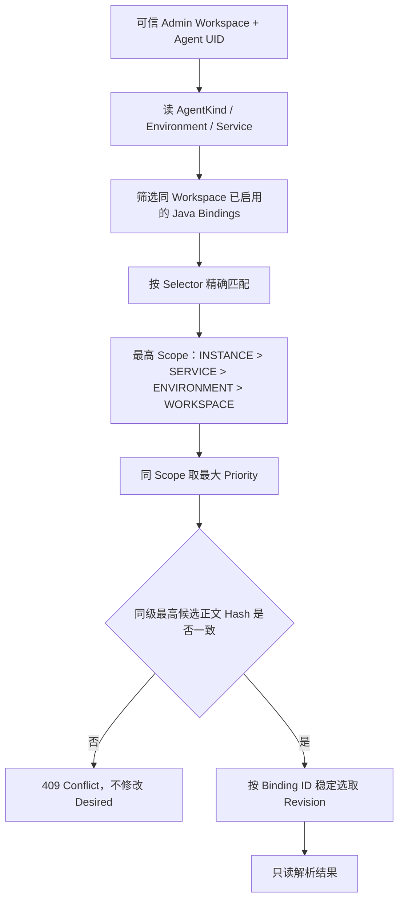

# P2.4：Java Sampling Policy 与 Selector 解析

> 实现阶段文档，仍服从 [DD-001](../design-docs/dd-001_opamp-control-plane.md) 的 Draft 和 [EP-001](../exec-plans/active/ep-001_build-control-plane/EXECPLAN.md) 身份安全阻塞。当前使用 Admin 静态 Credential → 可信 `workspace_id`；并未接入生产 IAM。

## 1. 功能边界

本增量使用 Goose 00004 增加 `policies`、`policy_revisions`、`policy_bindings`，并为既有 `config_revisions.source_policy_revision_id` 添加同 Workspace 外键。PostgreSQL/MySQL 保持同一业务语义、独立 SQL Migration、统一 GORM Repository。

首期只创建 Java `head_sampling` Policy；策略正文规范化为 `{"schema_version":1,"sampling":{"type":"parent_based_trace_id_ratio","rate":0.15}}`，以正文 SHA-256 标识内容。Policy Revision 永不 Update/Delete；创建下一版本时锁住父 Policy，保障并发版本号递增。Binding 使用 `row_version` CAS 更新，可禁用或切换到新的 Revision。

**解析操作没有副作用**：Resolver 不创建 ConfigRevision/Release/Assignment，也不发送 OpAMP。已有 `POST /api/v1/agents/{uid}/releases` 仍是唯一持久发布入口。批量目标冻结/自动策略发布属于下一交付阶段，不能将解析成功冒称已经应用。

## 2. HTTP 接口

均需要现有 Admin Bearer Token，Workspace 由令牌配置确定，禁止从请求体传入：

| 方法与路径 | 输入 | 结果 |
| --- | --- | --- |
| `POST /api/v1/policies` | `{"name":"checkout","sampling_rate":0.15}` | 201，Policy + 初始 Revision（编号 1） |
| `POST /api/v1/policies/{policy_id}/revisions` | `{"sampling_rate":0.20}` | 201，新不可变 Revision |
| `POST /api/v1/policy-bindings` | `{"policy_revision_id":"UUID","scope_type":"SERVICE","selector":{"service_name":"checkout","environment":"prod"},"priority":10}` | 201，默认 enabled |
| `PUT /api/v1/policy-bindings/{binding_id}` | 同上，加 `"enabled":false,"row_version":1` | 200，CAS 修改；过期版本 409 |
| `GET /api/v1/agents/{uid}/policy-resolution` | 无请求体 | 200，匹配 Binding/PolicyRevision/Hash/完整策略 JSON |

请求采用严格 JSON，未知字段、不兼容 Selector 或非法 rate 返回 400；跨 Workspace 隐藏为 404；Java 之外的 Agent Kind 返回 422；最高优先级冲突返回 409。所有失败不改变 Desired。

## 3. 匹配与冲突

Selector 约束：`WORKSPACE` 使用空对象；`ENVIRONMENT` 只接受 `environment`；`SERVICE` 必须指定 `service_name`，可附带 `environment`；`INSTANCE` 使用小写 32 位十六进制 `instance_uid`。Scope 名称固定为 `WORKSPACE`、`ENVIRONMENT`、`SERVICE`、`INSTANCE`；`TENANT` 不支持。

相同 Scope+Priority 下，只有最高优先级候选之间的不同正文 Hash 构成冲突。低优先级 Binding 冲突不影响更高优先级的确定性结果；相同正文 Hash 的重复 Binding 选择字典序最小的 Binding ID，不声称发生新的发布。

## 4. 验证与后续边界

验证要求：严格 gofmt、Go Race/Vet、RepoFoundry、PostgreSQL 17/MySQL 8.4 Goose 00004 与真实 API/Repository 合同。合同覆盖 Workspace 越权、Scope 优先级、同级冲突、重复内容、Binding CAS、不可变 Revision 并发编号及只读 Resolver 不产生 Assignment。

本增量不改变现有 OpAMP Gateway、WS Writer、ACK 状态机、旧 Release API、Policy 批量发布；不增加多 Adapter Factory、Tenant 层、分布式缓存或消息队列。后续如需按策略自动发布，必须在 Release 事务边界明确冻结目标、幂等键与审计，不使用 Resolver 的查询结果直接改写 Desired。
