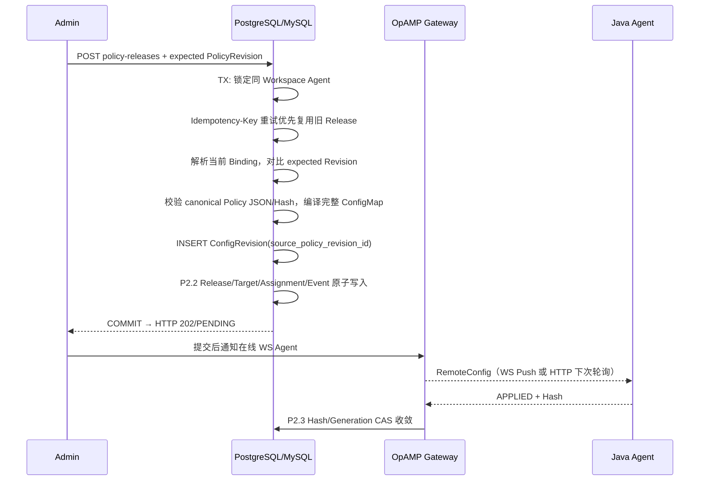

# P2.5：Policy → ConfigRevision → 单 Agent 原子发布

> 状态：P2.5 增量开发合同。DD-001 仍为 Draft，EP-001 生产身份安全阻塞不变。本功能沿用静态 Admin Credential 到 `workspace_id` 的可信部署映射，不构成 IAM 审批或 JVM 热更新证明。

## 1. 路径与执行语义

新增 `POST /api/v1/agents/{uid}/policy-releases`，正文仅接受 `{"policy_revision_id":"UUID"}`，可选请求头 `Idempotency-Key`。Admin 先通过 P2.4 `GET /api/v1/agents/{uid}/policy-resolution` 确认命中 Revision，再显式请求发布；服务端在发布事务内重新解析，必须命中**请求指定的同一 Revision**。期望 Revision 在当前 Workspace 内不存在时返回 404（无论是否有其他 Binding 命中）；存在但已不再是目标当前命中策略时返回 409（包括 Binding 被禁用或 Selector 改变）；Agent 不存在时返回 404；非 Java Agent、无 RemoteConfig 能力返回 422。

发布基于事务内 Binding 解析查询返回的候选集做出选择，已读取的启用 Binding 在事务提交前受到共享锁保护。PostgreSQL 允许查询完成后插入新的高优先级 Binding，该 Binding 从后续发布起生效（集成测试覆盖）。MySQL 8.4 默认 InnoDB REPEATABLE READ 下，`FOR SHARE` 的范围锁或 next-key 锁可能阻塞相同索引范围内的插入，不保证与 PostgreSQL 相同的插入并发性；具体锁范围由执行计划决定。发布不保证在提交瞬间仍是最新绑定，不引入 Workspace 级别的串行锁。单 Agent 的 Desired Generation 仍通过 Agent 行锁串行化。

发布复用 P2.2 单 Agent 事务实现，不复制 Assignment CAS/审计逻辑。新增 ConfigRevision 与 Release/Target/Assignment/Event 同一个数据库事务；任何后续失败均回滚 ConfigRevision，没有孤立的已编译版本。网络通知始终在提交之后，不在事务内发送。

## 2. 来源与幂等

- `config_revisions.source_policy_revision_id` 固定指向编译来源的不可变 Policy Revision。
- `config_releases.policy_revision_id` 记录本次策略发布的来源；当前 `release_targets` 仍只冻结一个 Agent。
- `ConfigHash` 沿用 P2.1 完整确定性 Protobuf ConfigMap 字节的 SHA-256。Policy `body_sha256` 是业务正文 Hash，二者不同，不得混用。
- 幂等请求 Hash 由模式标识、UID、显式指定的 PolicyRevision ID、Actor 计算。Workspace + `Idempotency-Key` 与原 Release API 共享唯一约束。重试返回原 Release 与原 ConfigRevision，不重复更新 Generation；相同 Key 不同请求冲突。
- 多次不同 Key 发布相同 Policy 可以得到不同 ConfigRevision/Release 和相同内容 Hash；匹配 ACK 仅证明当前内容，不证明再次触发了 JVM 采样更新。

## 3. 边界和验收

本次**不新增 Migration**，不改动 `POST /api/v1/agents/{uid}/releases` 的直接配置发布契约，也不自动发布 P2.4 Resolver 的只读请求结果。Java 是唯一已编译类型；不支持 P3 多 Agent Selector/灰度、Collector/Go/Python Adapter、跨节点会话或生产平台 IAM。

PR 验证应包含 Go 严格格式、Race/Vet、RepoFoundry 与真实 PostgreSQL 17/MySQL 8.4 API + Storage + OpAMP 合同，覆盖 Workspace/AgentKind 隔离、禁用 Binding 后的 409、未知 Revision 在有无匹配 Binding 时的 404、已存在但未选中 Revision 的 409、PostgreSQL 读取后新增 Binding 的并发边界、幂等/Key 冲突、发布后 Hash ACK，以及审计失败导致 ConfigRevision 与 Desired 一并回滚。不得将 `202/PENDING` 称为已经 APPLIED。
