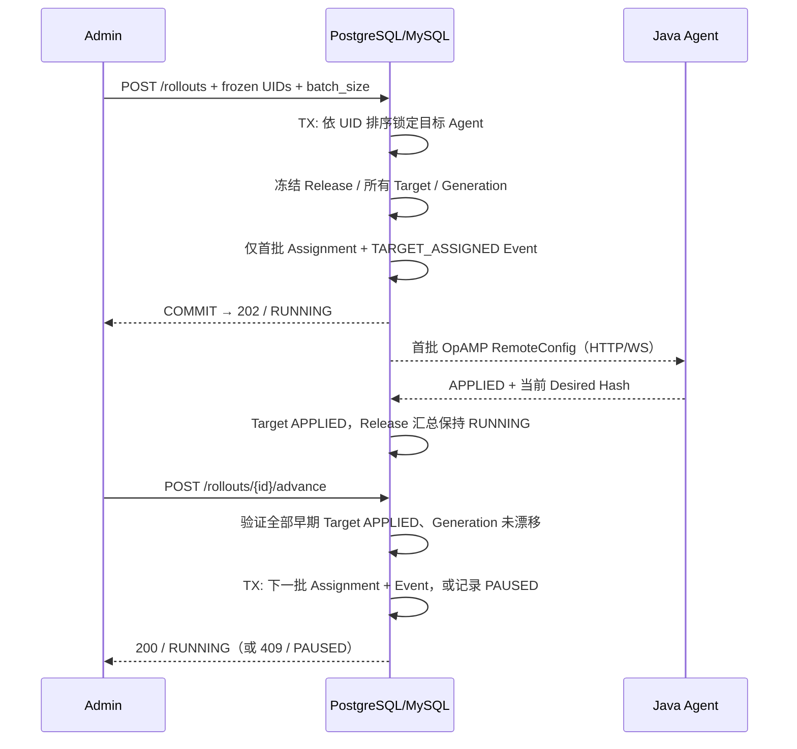

# P3.1：有界多 Agent 冻结目标与分批发布

> 实现合同（非设计审批）。[DD-001](../design-docs/dd-001_opamp-control-plane.md) 仍为 Draft，[EP-001](../exec-plans/active/ep-001_build-control-plane/EXECPLAN.md) 的身份安全阻塞继续有效。本增量不声明平台 IAM、跨实例 HA、真实 JVM 采样已完成。

## 目标

复用 P2.2/P2.3 的 `config_releases`、`release_targets.batch_no`、`agent_assignments`、`config_events`。一次管理请求显式提交 **2–16 个不同的 Java Agent UID**、已有的 ConfigRevision 和正整数 `batch_size`。所有 UID 先按字典序稳定排序；Workspace 来自可信 Admin Bearer Credential，不来自请求。

一个数据库事务完成 Release、全部 Frozen Target、首批 Desired Assignment 和审计事件。后续批次仅写 Target `QUEUED`，**不写 Agent Assignment、不提前发送 RemoteConfig**。所有 Target 冻结 `config_revision_id`、`batch_no` 和预期 `desired_generation`；改变时须创建新发布，不能静默修改旧 Target。

当前发布集合固定为显式 UID 列表，不执行动态 Policy Selector、多 Agent 自动发现或超出 16 个目标的分布式分块事务。原因是尚无超大规模发布的原子性/容量契约，不假设多事务提交具备同一原子结果。

## 管理接口

| 方法 | 路径 | 契约 |
| --- | --- | --- |
| POST | `/api/v1/rollouts` | 正文 `{"config_revision_id":"UUID","instance_uids":["32-char-hex","..."],"batch_size":1}`，可选 `Idempotency-Key`；202 返回冻结快照、状态和刚激活 UID |
| GET | `/api/v1/rollouts/{release_id}` | 200 返回持久 Release/Target 状态，跨 Workspace 返回 404 |
| POST | `/api/v1/rollouts/{release_id}/advance` | 当前批次全部 APPLIED 才提交下一批；尚未收敛返回 409，不做数据写入 |

发布请求里的 UID 数量为 2–16，重复 UID、未知字段、不支持的 BatchSize 明确 400；Workspace 内 Agent 或 ConfigRevision 缺失返回 404；目标缺少 Java Kind/RemoteConfig Capability 或 Dialect 不兼容返回 422。幂等 Key 在 Workspace 内与原 P2 Release 入口共享唯一约束，相同 Key+同请求仅返回原 Release，Key 冲突返回 409。

## 协调与状态

- Target 使用 `QUEUED`（尚未激活）、`PENDING`、`WAITING_ACK`、`APPLYING`、`APPLIED`、`FAILED`、`UNSUPPORTED`、`SUPERSEDED` 等值。已有数据库状态列是字符串，无需新 Migration。
- Release `RUNNING` 表示有未完成目标；只有**所有**冻结 Target 都得到当前 Desired Hash 的 `APPLIED` 才标记 `COMPLETED`。
- 任一目标 `FAILED`/`UNSUPPORTED`/`TIMED_OUT`，或后续批次发现冻结 Generation 与当前 Agent Assignment 不一致时，整次 Release 转为**粘性 `PAUSED`**，不继续推进。新的单 Agent 发布或 Rollout 若覆盖已激活的旧 Target，会在同一事务中将旧 Target 置为 `SUPERSEDED`、将旧多 Agent Release 置为 `PAUSED` 并记录审计事件，不等待旧 Agent 再次 ACK 或管理端再次 Advance。当前没有原地恢复/重试审批接口；纠正后通过新的受审计 Release 发布。
- 旧 ACK 依然由 P2.3 使用 Hash、Generation、RowVersion CAS 保护，不能使更晚发布误判为 APPLIED。相同 Hash 的报告只证明配置内容，不证明重复应用动作。
- 手动推进与单 Agent 发布使用同一 Agent 锁顺序；确认冻结 UID 列表后锁定 Agent，再对 Release 使用 CAS。数据写入与网络发送分离，事务成功后才以可丢失通知唤醒在线 WS，HTTP 在下次 Polling 时读取 Desired。
- 重启后从 Release/Targets/Assignments 读取进度；未激活的批次不需要进程内调度队列。重复 Advance 在未收敛时返回 409；Completed 再次 Advance 返回 Completed 快照，不产生新的 Assignment。GET 对 `PAUSED` 仍返回 HTTP 200；同 Key 的 POST 幂等重试仍返回 HTTP 202，不再次激活；Advance 返回 409。

## 明确未实现

P3.1 **不**包含 Policy Binding 自动多 Agent 枚举、百分比灰度/批次审批、手动恢复 Paused、自动 Advance、按单 Agent 回滚或全量 Rollback、百万目标发布、跨节点 WS Session Ownership、生产 TLS/IAM 或真实 JVM 采样应用证明。DD-001 Draft 和 EP-001 Blocked 状态不因通过 CI 自动解除。

## 验证

要求 PR 最新 Head 上严格 gofmt、go test -race、go vet、RepoFoundry 与真实 PostgreSQL 17/MySQL 8.4 合同测试。验收覆盖重复 UID、跨 Workspace、ConfigRevision Capability、不提前下发 Queued、全量冻结原子性、失败审计回滚、Hash-matched ACK 才可 Advance、Target Failure 停止扩散、Generation 漂移与 Store 重开恢复。
